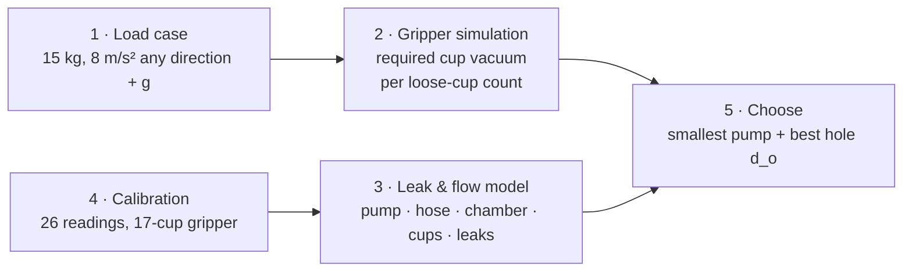
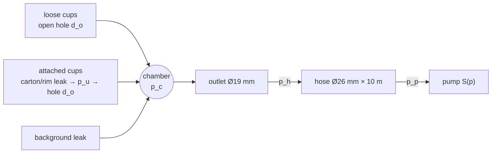
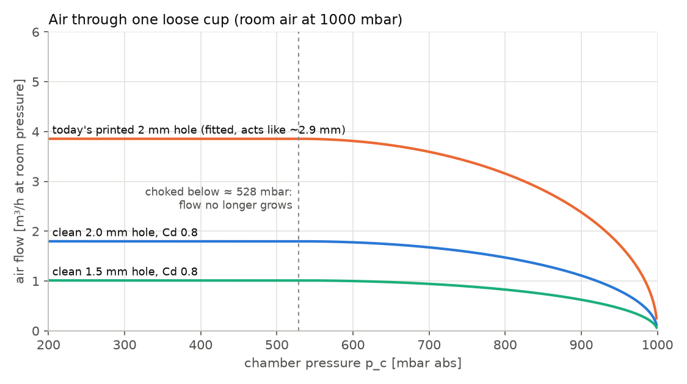
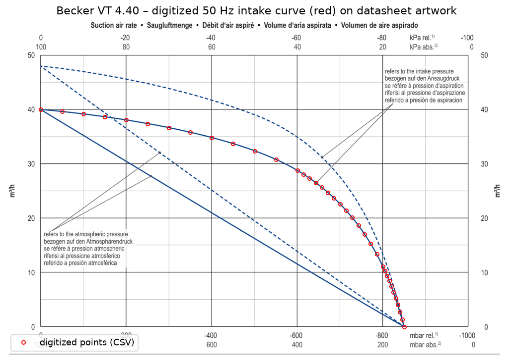
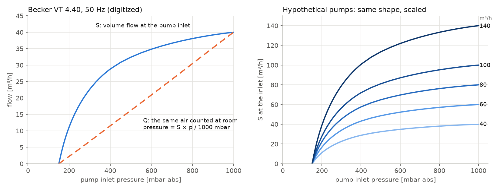
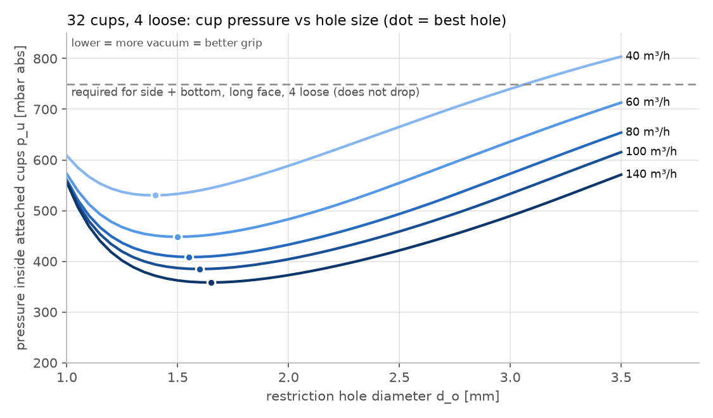

# Vacuum Sizing Pipeline — From Robot Acceleration to Pump and Cup Hole

*Engineering reference · 2026-10-28 · Gripper knowledge / 02. Sources: the local `VacuumDeptConfig` and `gripper-config` (branch `vacuum-study`) working trees.*

[Open the interactive version](vacuum-sizing-pipeline.html) · [01 · the office cup](standard-suction-cup.md) · [R&D index](index.html)

## In one paragraph

A suction cup holds because the room air presses the carton onto the cup harder than the thin air inside the cup presses back: **force = pressure difference × effective area**. Choosing a vacuum pump therefore means choosing a pump that keeps the pressure **inside the attached cups** low enough while air leaks in everywhere: through loose cups (open holes), through the cardboard and along the rims of the attached cups, and through the gripper itself. We get there in five steps. (1) Define the load: a 15 kg carton and a robot acceleration of up to 8 m/s² in any direction. (2) A gripper simulation finds the lowest cup vacuum that keeps the carton held, for 0–10 loose cups. (3) A leak-and-flow model of the whole vacuum system predicts the cup pressure for any pump and cup hole. (4) That model is calibrated on 26 pressure readings of our 17-cup gripper. (5) The smallest pump and the best cup hole diameter that meet the requirement are selected.

---

## 1. Vacuum in one minute

| Name | Meaning | Example |
|---|---|---|
| Absolute pressure | measured from perfect vacuum; the room is about 1000 mbar | 400 mbar abs |
| Gauge pressure | measured from room pressure (what most dials show) | −600 mbar = −60 kPa |
| Vacuum depth $v$ | how far below room pressure, as a positive number | 60 kPa |

1 kPa = 10 mbar. With the room at 1000 mbar (the value used throughout), the pressure inside a cup is

$$p_u = 1000\ \text{mbar} - 10\,v\,[\text{kPa}].$$

**Holding force of one cup:**

$$F = (p_a - p_u)\,A_\text{eff}$$

Our Ø41 mm office cup pulled off at 4.2 kg = 41.19 N at about 60 kPa, so $A_\text{eff} \approx 41.19\ \text{N} / 60\ \text{kPa} \approx 6.9\ \text{cm}^2$ (like a Ø30 mm disc). At 40 kPa the same cup holds about 2.8 kg straight up.

---

## 2. Steps 1–2: from acceleration to the required cup vacuum

### 2.1 The load case

The robot may accelerate the gripper at up to $|\vec a| = 8\ \text{m/s}^2$ in **any** direction. The carton must follow, so the cups have to supply

$$\vec F_\text{cups} = m\,(\vec a + g\,\hat z), \qquad m = 15\ \text{kg},\ g = 9.81\ \text{m/s}^2.$$

Accelerating straight up is the heaviest pull: $15 \times 17.8 \approx 267$ N. Sideways components add shear and tipping moments. In the MuJoCo simulator the acceleration is applied as an extra, sustained "gravity" $(-a_x,\,-a_y,\,-g-a_z)$ after a 0.6 s ramp, and held for the whole 6 s test. That is conservative: real robot moves are shorter.

### 2.2 The cup in the simulation

Each cup is a stretchy, non-linear spring calibrated on the office cup (see [part 01](standard-suction-cup.md)). For this study its force is scaled with the vacuum depth $v$. This is a hypothesis: only the 60 kPa behaviour is measured.

$$F(d) = B\,\frac{v}{60}\,\ln\!\left(1 + \frac{d}{A}\right), \qquad B = \frac{g}{0.7669} = 12.787\ \text{N},\quad A = 1.372\ \text{mm}$$

$$F_\text{pull-off} = 41.19\ \text{N} \cdot \frac{v}{60}$$

- $d$ is the stretch of the cup from its sealed state.
- **Shear** is resisted elastically up to a friction capacity $\mu\,(F_\text{pull-off} - T + C)$, with $\mu = 0.5$, $T$ = tension and $C$ = compression.
- **A cup lets go** by **pull-off** (tension ≥ $F_\text{pull-off}$) or by **peeling** (the cup tilts more than **30°**).
- **Sliding** never releases a cup on its own: the slip limit is set to the simulator maximum of 100 mm. The carton sliding away is still caught by the hold criteria below.

### 2.3 Grips, loose cups and directions

| Item | Setting |
|---|---|
| Carton | 15 kg, 600 × 300 × 300 mm, centre of mass in the middle |
| Top grip | "Top only · 180°", only chamber A grips (16 cups); chamber B's 16 cups are plugged; carton centred under A |
| Side + bottom | "Side + bottom · 90°", 32 cups; side chamber on the 300 × 300 **end face** (carton 600 mm deep) or on the 600 × 300 **long face** (carton 300 mm deep) |
| Loose cups | 0 to 10, starting at the sides. Two orders, the worse one counts. **Symmetric:** outer columns along the carton sides (±Y) first, alternating +Y/−Y, then inward. **One-sided:** +Y side first, column by column. |
| Directions | 26 unit vectors (±X, ±Y, ±Z, 12 edge and 8 corner diagonals), then 8 neighbours at 15° and at 7.5° around the worst |
| Vacuum search | bisection between 1 and 100 kPa, resolution 0.5 kPa. The required vacuum is the maximum over all directions, and the reported value is a holding one. |

### 2.4 When is the carton "held"?

| Criterion | Fails when (at the end of the test) |
|---|---|
| **Does not drop** | floor contact, all cups released, mean displacement still growing by more than 2 mm/s ("creeping"), peak displacement over the last second > 100 mm, or tilt > 30° |
| **Held in place** | the same, but with sag > 25 mm or tilt > 10° |

Extra cups may let go as long as the criterion holds.

**Output of steps 1–2:** for each grip and number of loose cups, the highest allowed pressure inside the attached cups, $p_{u,\max} = 1000 - 10\,v_\text{required}$ mbar.

---

## 3. Step 3: the leak and flow model

The vacuum system is a chain:

- Room air enters through the **loose cups**, through the **attached cups** (carton and rim leak), and through a **background leak** of the gripper.
- It collects in the **chamber** (pressure $p_c$), then flows through the **outlet** (Ø19 mm) to the start of the **hose** ($p_h$), and along the 26 mm × 10 m hose to the **pump** ($p_p$).
- In steady state the same **mass** of air passes every link each second, so the model balances mass flow $\dot m$ [kg/s].

### 3.1 Air as an ideal gas

$$\rho = \frac{p}{R\,T}, \qquad Q = \frac{\dot m\,R\,T}{p}, \qquad R = 287.05\ \tfrac{\text{J}}{\text{kg K}},\ T = 293.15\ \text{K}.$$

The same mass flow occupies a larger volume at low pressure. "m³/h at room pressure" ($Q_a$, with $p = p_a$) is the volume the air had in the room.

### 3.2 The pump

$$\dot m_p = \frac{p_p\,S(p_p)}{R\,T}$$

$S(p)$ is the volume flow the pump takes in **at its own inlet pressure** $p_p$. We use the Becker VT 4.40 50 Hz curve $S_B(p)$ (section 4) for the current Wordfik VD40. A hypothetical pump of nominal size $S_\text{nom}$ keeps the same curve shape and the same 150 mbar ultimate pressure:

$$S_\text{scaled}(p) = \frac{S_\text{nom}}{40\ \text{m}^3/\text{h}}\,S_B(p).$$

### 3.3 Air through a hole

This covers a loose cup, a cup restriction, and the leak equivalents. The model uses compressible flow through a restriction:

$$\dot m = C_d\,a\,\frac{p_\text{up}}{\sqrt{R\,T}}\;\Phi(r), \qquad r = \frac{p_\text{down}}{p_\text{up}}$$

$$\Phi(r) = \sqrt{\frac{2\gamma}{\gamma-1}\left(r^{2/\gamma} - r^{(\gamma+1)/\gamma}\right)} \quad (r > r^*), \qquad \Phi^* = \sqrt{\gamma}\left(\frac{2}{\gamma+1}\right)^{\frac{\gamma+1}{2(\gamma-1)}} \approx 0.685 \quad (r \le r^*)$$

$$r^* = \left(\frac{2}{\gamma+1}\right)^{\gamma/(\gamma-1)} \approx 0.528, \qquad \gamma = 1.4.$$

- $a$ is the hole area. $C_d$ (discharge coefficient) is the fraction of the area the jet really uses: about 0.8 for a clean drilled channel 5 mm long.
- **In plain words:** the lower the chamber pressure, the more air rushes in, until the air in the hole reaches the speed of sound. Below about 528 mbar in the chamber, a hole fed from the room is **choked**: it passes a fixed maximum, however hard the pump pulls.

### 3.4 An attached cup: two holes in series

Air seeps through the cardboard and along the rim into the cup. This is modelled as one equivalent hole $a_s$ per cup, fitted to 0.35 mm². The air then has to pass the cup's restriction hole $a_o$ into the chamber. The cup pressure $p_u$ settles where both flows are equal:

$$\dot m_\text{seal}(p_a \rightarrow p_u;\ a_s) = \dot m_\text{hole}(p_u \rightarrow p_c;\ C_d\,a_o), \qquad p_c \le p_u \le p_a.$$

A small restriction hole makes $p_u$ rise far above $p_c$, which is why a too-small hole hurts the attached cups.

### 3.5 Background leak

This is one equivalent hole of the gripper (seals, fittings) into the chamber, fitted to 4.7 mm². The plugs of unused branches are assumed tight.

### 3.6 Hose and outlet losses

Isothermal, low-Mach pipe flow (Mach is checked to stay below 0.3):

$$p_\text{up}^2 - p_\text{down}^2 = \left(f_D\,\frac{L}{D} + K\right)\frac{R\,T}{A^2}\,\dot m^2$$

- $f_D$ is the Darcy friction factor from the Churchill (1977) correlation, which is continuous from laminar to turbulent. It uses $Re = \dot m\,D/(A\,\mu)$, with $\mu$ from Sutherland's law and a smooth hose ($\varepsilon$ = 1.5 µm).
- $K$ collects couplings and fittings:
  - hose: $K$ = 41, fitted;
  - outlet: sharp entry 0.5, plus the widening $(1 - A_g/A_h)^2$, plus 1.8 fitted.

### 3.7 Putting it together

$$N_\text{open}\,\dot m_\text{open}(p_c) + N_\text{att}\,\dot m_\text{att}(p_c) + \dot m_\text{bg}(p_c) = \dot m_p(p_p)$$

The solver works as follows:

1. Guess the pump inlet pressure $p_p$.
2. Get the pump mass flow from the curve.
3. Walk upstream through hose and outlet to $p_c$.
4. Add up all inflows at $p_c$, solving every attached cup for its own $p_u$.
5. Adjust $p_p$ with Brent's method until inflow equals what the pump removes.

The bracket runs from the pump's ultimate pressure (inflow > pump flow) up to the point where $p_c$ reaches room pressure (inflow = 0), so a valid solution is always found or reported as missing.

---

## 4. The pump curve: Becker VT 4.40

No curve exists for our Wordfik VD40, so its catalogue twin, the Becker VT 4.40 (40 m³/h, 150 mbar, 1.25 kW at 50 Hz), stands in. The curve was **extracted exactly from the vector drawing** in the datasheet PDF (page 2), not traced by eye:

- the two cubic Bézier segments of the solid 50 Hz upper line were read directly;
- the axes were calibrated on the major grid lines, with a residual below 0.002 mbar;
- the uncertainty of the drawing itself is about ±1.3 mbar and ±0.1 m³/h (half the stroke width).

The manufacturer's ±5 % tolerance is separate, and so is the uncertainty of using a Becker curve for a Wordfik pump.

The datasheet shows two solid 50 Hz lines:

- **upper line:** the flow **at the inlet pressure**, $S(p)$. This one is used in the model.
- **lower line:** the same air counted at atmospheric pressure, $Q(p) = S(p)\cdot p/1000$.

At 400 mbar the pump swallows 28.8 m³/h of thin air, which took up only 11.5 m³/h in the room. Leak flows are counted at room pressure, so the lower line is what the pump can "afford" to leak.

| p [mbar abs] | 150 | 160 | 200 | 300 | 400 | 600 | 840 | 1000 |
|---|---|---|---|---|---|---|---|---|
| S [m³/h] | 0 | 2.75 | 11.15 | 22.62 | 28.80 | 34.84 | 38.55 | 40.00 |

Source: [Becker VT 4.40 datasheet](https://www.beckerpumps.com.au/wp-content/uploads/2024/01/ds_VT_4.40.pdf). The digitized table is in `VacuumDeptConfig/data/becker_vt440_50hz_inlet.csv`, with provenance in its header.

---

## 5. Step 4: calibration on our measurements

Three analog gauges were read for 26 configurations of the current 17-cup gripper with the VD40 pump: pump inlet $p_p$, hose start $p_h$, and chamber $p_c$.

| Series | Configuration | What it shows |
|---|---|---|
| A1 | all 17 restriction holes plugged | background leak |
| B1–B17 | 1–17 holes open, the rest plugged | flow through open holes |
| C1–C8 | cups on a carton, the rest open | carton and rim leak of attached cups |

**The puzzle (Phase 1 diagnostics).** To carry the flow the Becker curve implies, the open 2 mm holes would need a discharge coefficient of 1.8–2.05 across the whole B series. A real hole can't exceed about 1. Two explanations fit all pressures equally well (within ≈ 8 mbar rms):

| Variant | Explanation | Consequence |
|---|---|---|
| **V1 "weaker pump"** | the VD40 delivers only ~47 % of the Becker curve | the hose would need an implausible extra loss (K ≈ 223) |
| **V3 "bigger opening"** (used) | the printed 2 mm holes pass as much air as clean ≈ 2.9 mm holes | plausible hose loss (K ≈ 41); the holes are 3D printed |

Both variants agree for today's pump, but they disagree by about 2× for other pumps. Two checks decide between them:

- gauge the printed holes with drill shanks;
- measure the pump's free-air flow (≈ 40 m³/h means V3).

The gauges were checked by the user and are treated as correct.

**Fitted values, model V3**

| Quantity | Value |
|---|---|
| Open hole, today (nominal 2 mm) | $C_d\,a$ = 5.39 mm² (behaves like a clean 2.93 mm hole at $C_d$ = 0.8) |
| Carton + rim leak per attached cup | 0.35 mm² equivalent hole (≈ Ø0.67 mm) |
| Background leak of the gripper | 4.7 mm² equivalent hole (≈ Ø2.45 mm) |
| Extra hose loss | K = 41 |
| Extra outlet loss | K = 1.8 |
| Pump | full Becker VT 4.40 curve |

Internal hold-out check: configurations C3, C5 and C7 were left out of the fit and predicted within 12–32 mbar.

---

## 6. Step 5: choosing the pump and the hole

**Why the hole size has a sweet spot:**

- **Holes too big:** every loose cup dumps a lot of room air into the chamber, and the chamber pressure rises.
- **Holes too small:** the air that seeps into an attached cup cannot get out fast enough, and the pressure *inside* the cup rises. That is the pressure that holds the carton.

The best hole lies in between. It moves to smaller holes when more cups are loose, and to slightly larger holes with a bigger pump.

Practical choice: **1.25–1.75 mm**, with **1.5 mm** as the robust middle. Use smaller holes when the required vacuum is low (long-face grip) and larger ones when it is high (end face, top grip). The optimum is flat, so ±0.2 mm costs at most about 10 mbar. A 1.0 mm hole never brings the attached cups below about 556 mbar, whatever the pump.

**Re-drilling note.** A printed hole that behaves like 2.9 mm cannot be drilled *down* to 1.5 mm. Fill it with epoxy and re-drill it, or drill it out and glue in a brass tube with the wanted inner diameter.

---

## 7. Results

**Bottom line (does not drop, 8 m/s², 15 kg):**

- **Side + bottom, long face:** easy. 17–36 kPa is enough; about 35 m³/h with 1.25 mm holes survives 10 loose cups.
- **Side + bottom, end face:** 39–74 kPa. With 1.5 mm holes, 41 m³/h covers 4 loose cups and about 90 m³/h covers 7; 9 or more loose cups need more than any pump up to 280 m³/h.
- **Top grip with one chamber:** 45–72 kPa for 0–4 loose cups (54 m³/h covers 3 loose with 1.5 mm holes); with 5 or more loose cups on one side the carton is not held at any vacuum.

<!-- results:start -->
Smallest pump (Becker shape, scaled) that keeps the attached cups at or below the required pressure, with the best of the listed holes (today's, 2.5, 2.0, 1.75, 1.5, 1.25, 1.0 mm). "not held" = not held at any vacuum in the gripper simulation; "> 280" = no pump up to 280 m³/h reaches it. Criteria: **Does not drop** (100 mm / 30°); **Held in place** (25 mm / 10°).

### Side + bottom, long face (32 cups)

| Loose cups | Does not drop: vacuum | max p_u | min pump · best hole | Held in place: vacuum | max p_u | min pump · best hole |
|---|---|---|---|---|---|---|
| 0 | 16.6 kPa | 834 mbar | < 20 m³/h · today | 18.6 kPa | 814 mbar | < 20 m³/h · today |
| 1 | 17.5 kPa | 825 mbar | < 20 m³/h · 1.5 mm | 19.5 kPa | 805 mbar | < 20 m³/h · 1.5 mm |
| 2 | 19.0 kPa | 810 mbar | < 20 m³/h · 1.25 mm | 21.0 kPa | 790 mbar | < 20 m³/h · 1.25 mm |
| 3 | 19.9 kPa | 801 mbar | < 20 m³/h · 1.25 mm | 22.9 kPa | 771 mbar | < 20 m³/h · 1.25 mm |
| 4 | 25.0 kPa | 750 mbar | < 20 m³/h · 1.25 mm | 28.0 kPa | 720 mbar | 21 m³/h · 1.25 mm |
| 5 | 24.5 kPa | 755 mbar | < 20 m³/h · 1.25 mm | 27.5 kPa | 725 mbar | 21 m³/h · 1.25 mm |
| 6 | 25.4 kPa | 746 mbar | 20 m³/h · 1.25 mm | 29.9 kPa | 701 mbar | 24 m³/h · 1.25 mm |
| 7 | 31.2 kPa | 688 mbar | 26 m³/h · 1.25 mm | 35.7 kPa | 643 mbar | 30 m³/h · 1.25 mm |
| 8 | 33.3 kPa | 667 mbar | 29 m³/h · 1.25 mm | 41.6 kPa | 584 mbar | 39 m³/h · 1.25 mm |
| 9 | 32.7 kPa | 673 mbar | 29 m³/h · 1.25 mm | 42.0 kPa | 580 mbar | 41 m³/h · 1.25 mm |
| 10 | 35.9 kPa | 641 mbar | 34 m³/h · 1.25 mm | 46.6 kPa | 534 mbar | 52 m³/h · 1.25 mm |

### Side + bottom, end face (32 cups)

| Loose cups | Does not drop: vacuum | max p_u | min pump · best hole | Held in place: vacuum | max p_u | min pump · best hole |
|---|---|---|---|---|---|---|
| 0 | 38.9 kPa | 611 mbar | 22 m³/h · today | 51.1 kPa | 489 mbar | 32 m³/h · today |
| 1 | 41.0 kPa | 590 mbar | 27 m³/h · 1.5 mm | 56.4 kPa | 436 mbar | 48 m³/h · 1.75 mm |
| 2 | 44.4 kPa | 556 mbar | 32 m³/h · 1.5 mm | 66.7 kPa | 333 mbar | 136 m³/h · 1.75 mm |
| 3 | 46.0 kPa | 540 mbar | 36 m³/h · 1.5 mm | 74.2 kPa | 258 mbar | > 280 m³/h |
| 4 | 47.2 kPa | 528 mbar | 41 m³/h · 1.5 mm | 90.3 kPa | 97 mbar | > 280 m³/h |
| 5 | 48.4 kPa | 516 mbar | 46 m³/h · 1.5 mm | > 100 kPa | — | not held |
| 6 | 51.5 kPa | 485 mbar | 57 m³/h · 1.5 mm | > 100 kPa | — | not held |
| 7 | 57.2 kPa | 428 mbar | 91 m³/h · 1.5 mm | > 100 kPa | — | not held |
| 8 | 63.3 kPa | 367 mbar | 274 m³/h · 1.5 mm | > 100 kPa | — | not held |
| 9 | 66.8 kPa | 332 mbar | > 280 m³/h | > 100 kPa | — | not held |
| 10 | 74.2 kPa | 258 mbar | > 280 m³/h | > 100 kPa | — | not held |

### Top grip, chamber A only (16 cups, chamber B plugged)

| Loose cups | Does not drop: vacuum | max p_u | min pump · best hole | Held in place: vacuum | max p_u | min pump · best hole |
|---|---|---|---|---|---|---|
| 0 | 44.8 kPa | 552 mbar | < 20 m³/h · today | 65.0 kPa | 350 mbar | 36 m³/h · today |
| 1 | 50.1 kPa | 499 mbar | 23 m³/h · 1.75 mm | 73.8 kPa | 262 mbar | 142 m³/h · 2 mm |
| 2 | 57.9 kPa | 421 mbar | 37 m³/h · 1.5 mm | 86.8 kPa | 132 mbar | > 280 m³/h |
| 3 | 62.0 kPa | 380 mbar | 54 m³/h · 1.5 mm | > 100 kPa | — | not held |
| 4 | 71.5 kPa | 285 mbar | 266 m³/h · 1.75 mm | > 100 kPa | — | not held |
| 5 | > 100 kPa | — | not held | > 100 kPa | — | not held |
| 6 | > 100 kPa | — | not held | > 100 kPa | — | not held |
| 7 | > 100 kPa | — | not held | > 100 kPa | — | not held |
| 8 | > 100 kPa | — | not held | > 100 kPa | — | not held |
| 9 | > 100 kPa | — | not held | > 100 kPa | — | not held |
| 10 | > 100 kPa | — | not held | > 100 kPa | — | not held |

<!-- results:end -->

Full tables per hole size, numerical checks and assumptions: [PDF report](assets/vacuum-sizing/VD40_gripper_vacuum_and_pump_requirements.pdf).

---

## 8. Assumptions, limits and what to measure next

- **Untested hypothesis:** cup force and stiffness scale linearly with vacuum. Only 60 kPa is measured, and the stretch law strongly affects the sag/tilt results.
- **Simplified mechanics:** the carton is rigid, the gripper is fixed, and the acceleration is sustained for the whole test.
- **Uniform vacuum:** all attached cups share one vacuum level. In the gripper simulation a loose cup carries no force; its air leak is handled in step 3.
- **Pump stand-in:** the pump is the Becker VT 4.40 curve (model V3). Bigger pumps are scaled copies with the same 150 mbar limit.
- **Extrapolation:** the 32-cup gripper is extrapolated from the 17-cup measurements, with the background leak kept constant.
- **Thresholds, not design values:** add a margin (e.g. +20 % force ≈ 1.2 × the required vacuum) before buying a pump.
- **Not a lifting-safety certification.**

**Next measurements, cheapest first:**

1. Gauge the printed holes with drill shanks. Does a 2.5–2.9 mm shank fit?
2. Measure the free-air flow of the current pump, for example with a flow meter on the atmospheric side of a throttle valve. About 40 m³/h means V3.
3. Measure the pressure inside one attached cup, before and after re-drilling.
4. Do a held / not-held test at one or two vacuum levels, measuring how far the carton sags.

---

## Source trail

- **Vacuum network model:** `VacuumDeptConfig/src/vacsim/`.
  - `gas.py`, `pump.py`, `restriction.py`, `cup.py`, `leaks.py`, `pipe.py`: the components.
  - `network.py`: the steady-state solver.
  - `calibrate.py`: the hypothesis variants.
  - `sizing.py`: pump and hole sizing.
- **Calibration:** `VacuumDeptConfig/config/calibration/V3_effective_area.json`; diagnostics in `reports/phase1_diagnostics.md` and `reports/validation_report.md`.
- **Pump curve:** `VacuumDeptConfig/scripts/digitize_becker.py` → `data/becker_vt440_50hz_inlet.csv`.
- **Gripper simulation:** `gripper-config`, branch `vacuum-study`: `gripper_sim/vacuum_study.py` (search), `gripper_sim/physics.py` and `settings.py` (cup model, vacuum scaling, loose cups, Y acceleration). Results in `output/vacuum-study-20261028-v2-{drop,hold}/summary.json`.
- **Reports:**
  - `VacuumDeptConfig/reports/VD40_gripper_vacuum_and_pump_requirements.pdf` (pump per grip and loose cups);
  - `VD40_32cups_hole_size_pump_study.pdf` and `VD40_hole_size_pump_study.pdf` (hole size);
  - figures and page data from `scripts/make_randd_doc_assets.py`.
